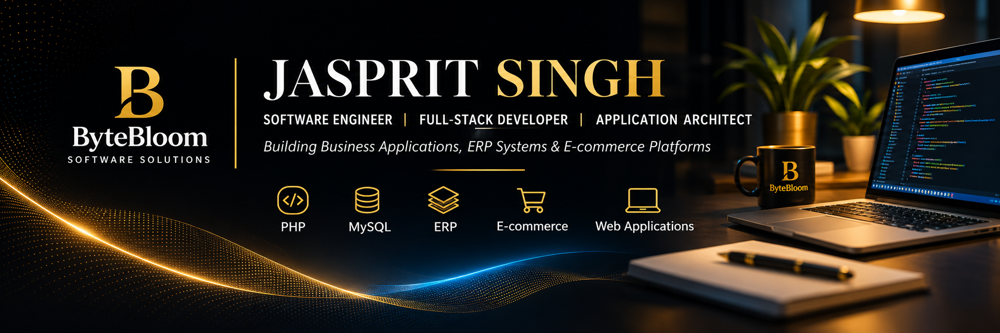

  

---

# JASPRIT SINGH

### Software Engineer · Full-Stack Developer · Business Applications

**Building business applications, ERP systems & e-commerce platforms**

PHP · MySQL · JavaScript · Application Engineering

---

## About

I engineer web applications and business systems — transforming operational requirements into structured, functional and maintainable software.

With **19+ years in software development**, my work spans application architecture, backend engineering, database design, business workflows, ERP platforms, e-commerce systems and ongoing software maintenance.

---

## Engineering Focus

| Domain | Focus |
|---|---|
| Business Systems | ERP, POS, management applications & workflows |
| Full-Stack Development | End-to-end web application development |
| Backend Engineering | PHP, application logic, APIs & integrations |
| Database Engineering | SQL, relational design & data integrity |
| E-commerce | Catalogue, cart, checkout & order processing |
| Application Security | Authentication, authorisation & secure workflows |

---

## Technology Stack

**Backend:** PHP · MySQLi · Node.js

**Database:** MySQL · MariaDB · MongoDB · SQL

**Frontend:** JavaScript · HTML5 · CSS3 · Bootstrap

**Frameworks:** React · Vue

**Architecture:** MVC · REST APIs · JSON · Modular Applications

**Tools:** Git · GitHub

---

## Featured Projects

### Restaurant ERP Management System

A modular restaurant management application built around business operations and multi-branch workflows.

- POS & Order Management
- Kitchen Order Ticket Management
- Payment Management
- Expense Management
- Inventory-related workflows
- Role-Based Access Control
- Audit Logging

`PHP` `MySQLi` `JavaScript` `ERP`

### Sugandhika — E-commerce Platform

An e-commerce application focused on handmade candles and soaps.

- Product & Catalogue Management
- Shopping Cart
- Checkout & Order Processing
- Administration
- MVC-based development

`PHP` `MySQL` `JavaScript` `E-commerce`

---

## Engineering Principles

- Maintainable and modular software
- Security & data integrity
- Root-cause debugging
- Practical application architecture
- Continuous improvement
- Reliable software maintenance

---

**Software that solves real business problems.**

[Portfolio](https://www.jaspritxbytebloom.com) · [LinkedIn](https://www.linkedin.com/in/jaspritxbytebloom) · [GitHub](https://github.com/jaspritxbytebloom)

